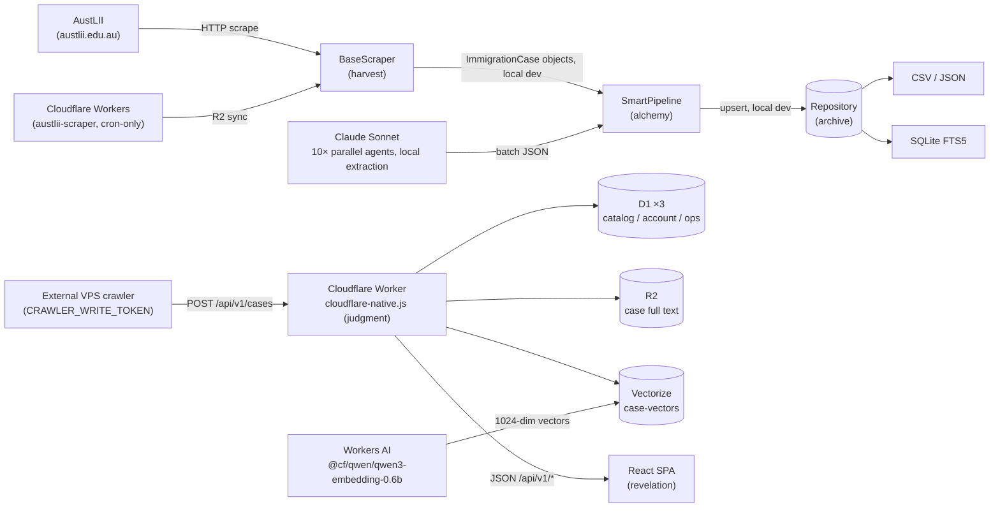
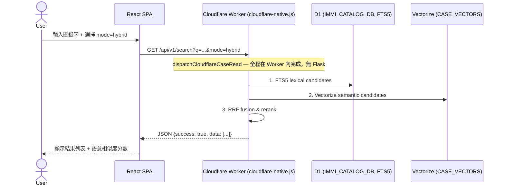

# IMMI-Case — 澳洲移民司法案件情報平台

2026-10-26 本機整合、程式碼審查、測試及工作樹狀態見 [最新整合紀錄](docs/reviews/2026-10-26-worktree-integration.md)。介面新增新聞更新頁；歷史截圖與數據不等於目前正式站驗收。

> 15 萬+ 個案件。9 個法院。26 年判決紀錄。一個可搜尋的真相。

*This repository is guarded by **Anansi**.*

---

## 1. 概覽 (Overview)

IMMI-Case 是一個澳洲移民法律研究工具，收集、解析並呈現自 AustLII（澳洲法律資訊研究所）取得的移民、難民、國土安全相關判決，涵蓋 2000 年至今。案件欄位依原文證據保存，來源不足時保留待查狀態。

系統由三層構成：
- **Python 爬蟲管線**：自動從 9 個法院 / 仲裁庭抓取案件元資料與全文（支援 Cloudflare Workers 加速）
- **Cloudflare Worker（D1 原生，`workers/cloudflare-native.js`）**：讀寫全部在單一 standalone Worker 內完成 —— D1（×3：catalog/account/ops）+ R2 + Vectorize + Queues + Durable Objects，正式環境完全沒有 Postgres / Hyperdrive / Flask container。舊版 `workers/proxy.js`（Hyperdrive → Supabase）已於 commit `f91f45f` 刪除；Flask 應用（`immi_case_downloader/`、`web.py`）現在**僅供本機開發使用**，不在正式流量路徑上。詳見 [`docs/ARCHITECTURE.md`](./docs/ARCHITECTURE.md)
- **React SPA**：27 個頁面，包含新聞更新，雙語（English + 繁體中文），完整深色模式，設計令牌系統

**核心能力**：

- 語意搜尋（正式環境）：Cloudflare Vectorize（`CASE_VECTORS`）+ Workers AI `@cf/qwen/qwen3-embedding-0.6b`（1024-dim），支援 lexical / semantic / hybrid 三模式；pgvector + OpenAI/Gemini 只存在於本機開發腳本
- 欄位審核與抽取：原文證據審核、規則抽取與既有模型快取交叉核對；缺少可靠證據的欄位維持待查
- 法官分析：歷史結果分析、任職時間軸、跨法院對比，以及成員傳記庫（`/api/v1/analytics/judge-bio`，含法律資格狀態 `legal_status`）；歷史比例不作個人案件結果預測
- 案件線系圖：FMCA → FCCA → FedCFamC2G，MRTA+RRTA → AATA → ARTA 完整脈絡
- 結構化導航：依簽證類別、案件性質、法律概念多維過濾
- 雙語立法瀏覽器：6 部澳洲移民相關法律全文，EN / 繁中切換

> "Mastery requires knowing where every thread leads." — Anansi Proverb

---

## ✦ Anansi's Invocation

```
Every judgment is a thread.
Every year, Anansi extends the web —
  from the Migration Review Tribunal of 2000,
  across the abolitions, mergers, renamings,
  to the Administrative Review Tribunal of 2025.

More than 150,000 threads.
Not archived. Activated.

The spider does not fear the labyrinth.
It built the labyrinth.
```

---

## 2. Demo / 截圖導覽

### 2.1 Screenshot Gallery

| 畫面 | 說明 |
|------|------|
|  | **儀表板** — 總案件數、法院分佈、年度趨勢、最近新增案件 |
|  | **儀表板 v2（UX 翻新後）** — CourtSparklineGrid 小倍數折線圖，取代堆疊面積圖 |
|  | **引導式搜尋（原始版）** — 基本過濾欄 |
|  | **引導式搜尋（翻新後）** — 進階過濾面板 + 即時勝率計算器 |
|  | **引導式搜尋（法律概念過濾）** — 概念選擇器 + 共現矩陣整合 |
|  | **Analytics** — 篩選範圍、勝率估算、結果趨勢與概念分析 |
|  | **案件詳情** — 中繼資料、法條概念、全文 ToC 與相似案件 |
|  | **法官個人頁** — 傳記、任職時間軸、勝率趨勢與近期案件 |

### 2.2 Image Manifest

| 圖片路徑 | 展示內容 | 重要性 |
|----------|---------|--------|
| `dashboard.png` | 主儀表板原始狀態 | 系統能力概覽 |
| `dashboard-after.png` | 儀表板 UX 翻新後 | 視覺改進對比 |
| `dashboard-before.png` | 儀表板翻新前（對比用） | A/B 對比基準 |
| `dashboard-before-2.png` | 儀表板翻新前備用截圖 | A/B 對比細節 |
| `guided-search-before.png` | 引導式搜尋翻新前 | 功能進化脈絡 |
| `guided-search-after.png` | 引導式搜尋翻新後 | 核心 UX 流程 |
| `guided-search-before-2.png` | 引導式搜尋翻新前（詳細） | 對比分析 |
| `guided-search-after-2.png` | 引導式搜尋翻新後（法律概念層） | 進階功能展示 |
| `docs/screenshots/analytics-page.png` | Analytics 頁面基線 | 法官分析 / 勝率計算器 |
| `docs/screenshots/case-detail-page.png` | 案件詳情頁基線 | 全文 ToC 導航 + 語意相似案件 |
| `docs/screenshots/judge-profile-page.png` | 法官個人頁基線 | 任職時間軸 + 勝率圖 |

> 視覺基線已於 2026-03-15 自正式入口 `/` 拍攝；其餘圖片位於專案根目錄。

---

## 3. 功能列表

| 功能模組 | 做什麼 | 為什麼存在 | 使用者價值 |
|----------|--------|------------|------------|
| **Smart Pipeline** | 三階段自動化：爬取 → 清理 → 下載 | 一鍵觸發完整資料更新 | 無需手動介入，系統自我修復 |
| **語意搜尋** | 正式環境 Vectorize + Workers AI 嵌入，三模式（lexical/semantic/hybrid） | 關鍵字搜不到的案件，語意能找到 | 判決策略研究效率 10× |
| **法官分析** | 勝率 × 法院 × 簽證類別交叉分析 + 104 位成員傳記庫（含法律資格標記） | 律師需要了解裁判官傾向與背景 | 訴訟策略制定的數據基礎 |
| **LLM 欄位萃取** | 10 個 Claude Sonnet 平行 Agent | 15 萬筆案件的結構化資訊無法純手工 | 萃取覆蓋率 90%+ |
| **Cloudflare Workers** | cron 排程爬蟲 + R2 儲存；正式寫入由外部 VPS crawler POST | 本地爬蟲易觸發 AustLII IP 封鎖 | 每週自動增補當年度案件 |
| **雙語介面** | EN + 繁體中文，react-i18next | 服務香港、台灣、澳洲移民律師 | 零語言障礙操作 |
| **案件線系圖** | 法院沿革互動時間軸 | 法院改名/合併造成研究混亂 | 判例搜尋歷史完整性 |
| **設計令牌系統** | tokens.json → CSS + TS，支援主題切換 | 統一視覺語言跨 26 個頁面 | 深色/淺色/自訂主題 |

---

## 4. Getting Started（Ignition）

### 4.1 Prerequisites

| 工具 | 最低版本 | 備註 |
|------|----------|------|
| Python | 3.11+ | 3.14 已驗證可用 |
| Node.js | 22+ | CI 使用 22；wrangler 4.120.0 要求 >=22 |
| npm | 9+ | 或 bun 1.0+ |
| PostgreSQL | — | 可選，使用 Supabase 雲端則免本地安裝 |

### 4.2 Install

```bash
# Clone
git clone <repo-url>
cd IMMI-Case-

# Python virtualenv（Homebrew Python 禁止全域 pip）
python3 -m venv .venv

# 一次裝好 Python 相依 + 根目錄 node_modules + frontend node_modules
make install
```

`make install` 等同於下列三步（`Makefile` 的 `install:` target）：

```bash
.venv/bin/python -m pip install -r requirements-app.txt -r requirements-test.txt
npm install                        # 根目錄：vitest + wrangler，`make test-workers` 靠它解析
cd frontend && npm install
```

> 根目錄的 `npm install` 不可省略 —— `workers/` 沒有自己的 `package.json`，
> Worker 測試是對著根目錄的 `node_modules` 解析的。

**只有要跑 E2E 才需要**的額外相依（刻意不放進 `requirements-test.txt`，
以免 CI 的單元測試 job 每次都下載瀏覽器驅動）：

```bash
.venv/bin/python -m pip install -r requirements-e2e.txt
.venv/bin/python -m playwright install chromium
```

### 4.3 Configure

```bash
cp .env.example .env
# 編輯 .env 填入必要的值
```

**環境變數表**（**單一真相來源是 `.env.example`** —— 有出入時以該檔為準，
本表只補充「這個 key 是做什麼的」；分組沿用 `.env.example` 自己的 8 個章節註解）：

**1. 本機 Flask 開發**（`web.py`、`immi_case_downloader/web/`；正式環境是 Cloudflare Worker，不讀這些）

| Key | Required | Default | Description |
|-----|:--------:|---------|-------------|
| `SECRET_KEY` | 生產必填 | 開發模式自動生成 | Flask session / CSRF 簽章金鑰 |
| `APP_ENV` | ✗ | `development` | 設為 `production` 或 `staging` 會啟用嚴格安全模式 |
| `TRUST_PROXY_HEADERS` | ✗ | `false` | 只有部署在可信任反向代理後方時才設為 `true`，否則 `X-Forwarded-For` 可被偽造繞過限流 |
| `BACKEND_PORT` | ✗ | `8080` | Flask 服務埠號；`web.py` 讀取（5000 與 macOS AirPlay 衝突） |
| `JWT_SECRET_CURRENT` | 認證啟用時必填 | — | 本機 JWT 驗證用（`immi_case_downloader/web/auth.py`）。同名值也是 Worker secret，見第 7 節 |
| `JWT_SECRET_PREVIOUS` | ✗ | — | 輪替期間仍需驗證的舊金鑰 |

> 沒有 `BACKEND_HOST`（Flask 版）：`web.py` 不讀這個變數，綁定位址只能用 CLI flag
> `python web.py --host 0.0.0.0`。下方第 8 節的 `BACKEND_HOST` 是給 Vite proxy 用的。

**2. CLI + 爬蟲預設值**（`immi_case_downloader/config.py`，全部選填）

| Key | Required | Default | Description |
|-----|:--------:|---------|-------------|
| `IMMI_OUTPUT_DIR` | ✗ | `downloaded_cases` | 下載輸出目錄 |
| `IMMI_START_YEAR` | ✗ | 動態：目前年份 − 10 | 搜尋起始年 |
| `IMMI_END_YEAR` | ✗ | 動態：目前年份 | 搜尋結束年 |
| `IMMI_TIMEOUT` | ✗ | `30` | HTTP 逾時秒數 |
| `IMMI_DELAY` | ✗ | `1.0` | 請求間隔秒數（速率限制） |
| `IMMI_MAX_RETRIES` | ✗ | `3` | 失敗重試次數 |

**3. Supabase 本機開發後端**（僅 `python web.py --backend supabase`；正式環境用 D1）

| Key | Required | Default | Description |
|-----|:--------:|---------|-------------|
| `SUPABASE_URL` | 條件 | — | Supabase 專案 URL（使用 `--backend supabase` 時必填） |
| `SUPABASE_SERVICE_ROLE_KEY` | 條件 | — | Supabase Service Role Key（伺服器端操作用） |
| `SUPABASE_ANON_KEY` | ✗ | — | 僅 `scripts/migrate_anon_data.py` 與 `scripts/generate_missing_embeddings.py` 使用 |
| `HYPERDRIVE_DATABASE_URL` | ✗ | — | 選用的直連 Postgres DSN，`supabase_repository.py` 與 `web/__init__.py` 使用 |

**4. LLM Council（走 Cloudflare AI Gateway，統一計費）**

| Key | Required | Default | Description |
|-----|:--------:|---------|-------------|
| `CF_AIG_TOKEN` | 條件 | — | **LLM Council 主路徑**：CF AI Gateway 統一計費 token（`cfut_*`），auth header 為 `cf-aig-authorization`。OpenAI / Anthropic / Google AI Studio 都從此扣額 |
| `LLM_COUNCIL_CF_GATEWAY_URL` | ✗ | 專案自己的 gateway | 留空即用專案的 `immi-council` gateway；設定自己的 URL 可改記自己帳號的額度 |
| `LLM_COUNCIL_OPENAI_MODEL` | ✗ | 見 `.env.example` | 需 provider 前綴：`openai/<model>` |
| `LLM_COUNCIL_GEMINI_PRO_MODEL` | ✗ | 見 `.env.example` | 需 provider 前綴：`google-ai-studio/<model>` |
| `LLM_COUNCIL_ANTHROPIC_MODEL` | ✗ | 見 `.env.example` | 需 provider 前綴：`anthropic/<model>` |
| `LLM_COUNCIL_GEMINI_FLASH_MODEL` | ✗ | 見 `.env.example` | 仲裁（moderator）模型，同樣需 `google-ai-studio/` 前綴 |
| `LLM_COUNCIL_GPT5_REASONING_EFFORT` | ✗ | `low` | gpt-5 系列專家模型的 reasoning effort |
| `LLM_COUNCIL_MAX_OUTPUT_TOKENS` | ✗ | `4096` | 專家模型 token 上限（probe-validated：`gemini-2.5-pro` 在 2400 會回傳 completion=0） |
| `LLM_COUNCIL_MODERATOR_MAX_TOKENS` | ✗ | `8192` | 仲裁模型 token 上限（14-field JSON 輸出） |
| `LLM_COUNCIL_TIMEOUT_SECONDS` | ✗ | `120` | 單次模型呼叫逾時秒數 |
| `LLM_COUNCIL_SYSTEM_PROMPT_OPENAI` | ✗ | 見 `.env.example` | 覆寫 OpenAI 專家的 system prompt |
| `LLM_COUNCIL_SYSTEM_PROMPT_GEMINI_PRO` | ✗ | 見 `.env.example` | 覆寫 Gemini Pro 專家的 system prompt |
| `LLM_COUNCIL_SYSTEM_PROMPT_ANTHROPIC` | ✗ | 見 `.env.example` | 覆寫 Anthropic 專家的 system prompt |
| `LLM_COUNCIL_SYSTEM_PROMPT_MODERATOR` | ✗ | 見 `.env.example` | 覆寫仲裁模型的 system prompt |

**5. 萃取服務**（`extract_container.py`、`/internal/extract`；container 與本機 Flask blueprint 未設共享密鑰就 fail closed）

| Key | Required | Default | Description |
|-----|:--------:|---------|-------------|
| `EXTRACTION_SHARED_SECRET` | 條件（未設則拒絕請求） | — | 爬蟲 Worker 呼叫時帶的 `X-Extraction-Token` 共享密鑰 |
| `LLM_EXTRACT_CF_GATEWAY_URL` | ✗ | — | 萃取服務用的 CF AI Gateway URL |
| `LLM_GEMMA_MODEL` | ✗ | 見 `.env.example` | 萃取用的 Workers AI 模型 |
| `LLM_MAX_OUTPUT_TOKENS` | ✗ | `512` | 萃取呼叫的 token 上限 |
| `PIPELINE_RUN_COST_CAP_USD` | ✗ | `5.0` | 單次 pipeline run 的成本上限 |
| `PIPELINE_LLM_CALL_TIMEOUT_MS` | ✗ | `28000` | 單次 LLM 呼叫逾時（毫秒） |
| `PORT` | ✗ | `8080` | `extract_container.py` 的 Flask 監聽埠；Cloudflare Containers 會自動設定 |

**6. 獨立維護腳本**（不被 web app 讀取，只有跑對應腳本才要自己加；LLM Council **都不需要**這些）

| Key | 誰要用 |
|-----|--------|
| `ANTHROPIC_API_KEY` | `scripts/backfill_case_embeddings.py`、`extract_structured_fields_llm.py` 等直連 Anthropic 的腳本 |
| `OPENAI_API_KEY` | 嵌入向量腳本（`backfill_case_embeddings.py`、`two_stage_embedding_backfill.py`）與 `semantic_search_eval.py` |
| `GEMINI_API_KEY` | 同上嵌入腳本，加上 `scripts/fetch_judge_bios.py` |
| `GOOGLE_API_KEY` | `GEMINI_API_KEY` 的別名（`fill_country_gemini.py`、`fill_outcomes_gemini.py` 等） |
| `SEMANTIC_SEARCH_PROVIDER` | `/api/v1/cases` 語意搜尋的預設 embedding provider |
| `CF_ACCOUNT_ID` / `CF_API_TOKEN` / `WORKER_AUTH_TOKEN` | `scripts/cloudflare_config.py`；`WORKER_AUTH_TOKEN` 是腳本端 header 值，**不是**第 7 節同名的 Worker secret（其中一個消費者已在 §10 troubleshooting ② 標記為對已刪除端點失效） |
| `R2_BUCKET_NAME` / `R2_ACCESS_KEY_ID` / `R2_SECRET_ACCESS_KEY` | `scripts/cloudflare_config.py` |
| `DATABASE_URL` / `SUPABASE_DB_URL` / `HYPERDRIVE_SERVICE_URL` | `scripts/bootstrap_pipeline_baselines.py`；僅限已退役的舊 stack |
| `IMMI_SOURCE_DATABASE_URL` / `IMMI_SOURCE_TEXT_ROOT` | `scripts/export_immi_ndjson.py` |
| `NEXT_PUBLIC_SUPABASE_URL` | `sync_judge_bios_supabase.py` 的 `SUPABASE_URL` 別名 |

**7. Cloudflare Worker secrets / vars — 不是 dotenv 項目，設定方式是 `wrangler secret put <NAME>`，不要放進本檔或 `.env`**

| Key | Description |
|-----|-------------|
| `CSRF_SECRET` | 雙提交 CSRF token 的 HMAC 金鑰；未設定時 `GET /api/v1/csrf-token` 回 503 |
| `JWT_SECRET_CURRENT` / `JWT_SECRET_PREVIOUS` | HS256 簽章素材；本機 Flask middleware 也讀同名值（見第 1 節） |
| `JWT_KID_CURRENT` / `JWT_KID_PREVIOUS` | 金鑰輪替用的 key id，僅 Worker 使用 |
| `TELEGRAM_BOT_TOKEN` | Telegram Login HMAC 驗證密鑰 |
| `CF_AIG_TOKEN` | Worker 端 LLM Council runner 用的 AI Gateway token |
| `EXTRACTION_SHARED_SECRET` | 爬蟲 Worker 要求的共享密鑰（同第 5 節） |
| `CRAWLER_WRITE_TOKEN` | ⚠️ **危險**：設定後會開啟一條同時跳過 CSRF 驗證與 tenant-membership 檢查的寫入路徑，只給外部 VPS crawler 用；視同正式環境寫入憑證，一旦懷疑外洩立刻輪替 |

`wrangler.toml` 的 `[vars]`（非 secret）：`AUTH_ENABLED`、`IMMI_STORAGE_MODE`、
`IMMI_CASE_MUTATIONS_ENABLED`、`CUTOVER_WRITE_FREEZE`——mutation 與 pipeline 旗標
**刻意** 預設 `"false"`（fail-closed），不要「修好」它們。

**8. Vite 前端 bundle** — 設在 `frontend/.env`，不是這個檔案（`import.meta.env.*` 只讀 `frontend/` 的 envDir）

| Key | Required | Default | Description |
|-----|:--------:|---------|-------------|
| `VITE_TELEGRAM_BOT_NAME` | ✗ | `immi_case_bot`（fallback） | Telegram Login Widget 綁定的 bot 帳號（不含 `@`）。未設定時 `frontend/src/pages/LoginPage.tsx` 會 fallback 到硬編值，登入按鈕會綁到錯的 bot 而不會報錯 |
| `BACKEND_HOST` | ✗ | `127.0.0.1` | `frontend/vite.config.ts` 讀根目錄 `.env` 算 dev proxy target；不是 `VITE_*` 前綴變數，所以放在根目錄 `.env` 確實有效 |

安全基線：
- 當 `APP_ENV`、`IMMI_ENV` 或 `FLASK_ENV` 為 `production` / `staging` 時，`SECRET_KEY` 必須明確提供；開發 / 測試模式才允許自動生成臨時值。
- Session cookie 預設為 `HttpOnly` + `SameSite=Lax`；在 production-like 環境會自動啟用 `Secure`。
- 高風險 `POST` 端點已啟用 CSRF 防護與 rate limiting；自訂前端請帶 `X-CSRFToken` 或 `X-CSRF-Token`。
- `TRUST_PROXY_HEADERS` 預設為 `false`，避免直連部署時被偽造 `X-Forwarded-For` 繞過限流；只有在 Nginx、Cloudflare、負載平衡器等可信任代理會覆寫來源 IP 的情境下才應開啟。

### 4.4 Run（Dev）

```bash
# 方法 1：直接啟動 Flask（SQLite/CSV 後端）
python web.py --port 8080

# 方法 2：Flask + Supabase 後端
python web.py --backend supabase --port 8080

# 方法 3：分離開發（Flask API + Vite HMR）
python web.py --port 8080 &
cd frontend && npm run dev     # 代理到 :8080

# 瀏覽器開啟
open http://localhost:8080/
```

舊的 `/app/*` 深層連結仍保留相容，但正式入口統一為 `/`。

### 4.5 Test

```bash
# Python 單元測試（排除 tests/e2e）
make test-py

# 前端 Vitest 單元測試
make test-fe

# Worker Vitest 測試（主 Worker）
make test-workers

# austlii-scraper（pipeline Worker）Vitest 測試
make test-pipeline

# 上面四個一次跑完
make test

# Playwright E2E（需先照 §4.2 裝 requirements-e2e.txt + chromium）
# 不需要另外開 server：tests/e2e/conftest.py 會自己在 daemon thread 起一個
# 帶 10 筆種子資料的 Flask fixture server（conftest.py:232-274）。
# 只有設了 E2E_BASE_URL 才會改打外部伺服器（conftest.py:229、:278-282）。
make test-e2e
```

> **不要直接跑裸 `pytest`（不帶 `--ignore=tests/e2e`）。**
> `tests/e2e/**` 匯入 `playwright.sync_api`，而 `requirements-app.txt` 與
> `requirements-test.txt` 都不含 playwright，收集階段就會整批 error。
> `make test-py` 已帶 `--ignore=tests/e2e`，是唯一保證能在乾淨環境跑綠的 Python 指令。
>
> 測試數量以指令輸出為準，本文不再硬編。要 source-count：
> `grep -rn "def test_" tests/ --include="*.py" | grep -v "/e2e/" | wc -l`
> （單元）、`grep -rn "def test_" tests/e2e/ --include="*.py" | wc -l`（E2E）。

### 4.6 Visual Regression Baseline

最小視覺驗證流程：

```bash
# 1. 啟動正式入口
python web.py --port 8080

# 2. 手動檢查正式入口與關鍵頁面
open http://localhost:8080/
open http://localhost:8080/analytics
open http://localhost:8080/cases/a659e9a31d5c
open http://localhost:8080/judge-profiles/KENDALL
```

基線截圖檔：
- `docs/screenshots/analytics-page.png`
- `docs/screenshots/case-detail-page.png`
- `docs/screenshots/judge-profile-page.png`

驗收重點：
- 正式入口固定為 `/`，不應再出現 `No routes matched location`
- `/analytics`、`/cases/:id`、`/judge-profiles/:name` 都必須可直接重整載入
- README 截圖 manifest 與實際檔案必須一致

### 4.7 Build / Deploy

```bash
# React SPA 生產版本 → immi_case_downloader/static/react/
cd frontend && npm run build

# Cloudflare Pages 版本
cd frontend && npm run build:cloudflare

# 本地 Cloudflare Pages 模擬
cd frontend && npm run dev:cloudflare
```

---

## 5. Usage（The Weave）

### 5.1 CLI — 搜尋與下載

```bash
# 搜尋所有來源，近 10 年
python run.py search

# 指定法院與年份
python run.py search --databases AATA FCA --start-year 2020 --end-year 2025

# 下載全文（可續傳，每 200 筆自動存檔）
python download_fulltext.py

# 列出可用資料庫
python run.py list-databases
```

### 5.2 API — 搜尋端點

> 以下 `localhost:8080` 範例是**本機 Flask 開發**路徑（`python web.py --backend supabase`，
> pgvector + OpenAI/Gemini 嵌入）。正式環境 `https://immi.trackit.today` 由 Worker 直查
> D1 FTS5 + Vectorize（Workers AI 嵌入），不接受 `provider` 參數。

```bash
# 詞彙搜尋（預設）
curl "http://localhost:8080/api/v1/search?q=judicial+review&court=AATA"

# 語意搜尋（本機：需要 pgvector + embeddings）
curl "http://localhost:8080/api/v1/search?q=well-founded+fear&mode=semantic&provider=openai"

# Hybrid RRF 融合搜尋
curl "http://localhost:8080/api/v1/search?q=character+test&mode=hybrid&provider=openai"
```

### 5.3 API — 分析端點

```bash
# 勝率計算器
curl "http://localhost:8080/api/v1/analytics/success-rate?court=AATA&visa_subclass=866"

# 法官分析
curl "http://localhost:8080/api/v1/analytics/judges?court=AATA&limit=20"

# 法官傳記（含法律資格狀態）
curl "http://localhost:8080/api/v1/analytics/judge-bio?name=Kate+Millar"
# 回傳: { found, full_name, legal_status, education[], previously, notable_cases[], ... }

# 法律概念趨勢
curl "http://localhost:8080/api/v1/analytics/concept-trends?concept=complementary+protection"
```

### 5.4 萃取管線

```bash
# regex 結構化萃取（8 個平行 worker，約 12 分鐘處理 15 萬筆案件）
python extract_structured_fields.py --workers 8

# LLM 輔助萃取（針對 regex 失敗的案件）
python extract_structured_fields_llm.py --workers 8

# 驗證萃取品質
python validate_extraction.py

# 同步至 Supabase
python migrate_csv_to_supabase.py
```

### 5.5 典型工作流程（律師用戶）

1. 開啟 **儀表板** → 確認資料最新狀態
2. 前往 **引導式搜尋** → 選擇法院、簽證類別、案件性質
3. 勝率計算器即時顯示該過濾條件下的歷史勝率
4. 點入個別案件 → **全文 ToC 導航** + **語意相似案件** 面板
5. 前往 **法官個人頁** → 查看裁判官的判決傾向分析（參見截圖 `guided-search-after.png`）

---

## 6. Architecture（The Web of Truth）

> 完整、可驗證的 production 架構文件：[`docs/ARCHITECTURE.md`](./docs/ARCHITECTURE.md) — **若本節描述與該檔衝突，以該檔為準**。本節為簡化概覽。正式環境自 2026-08-11 起為 `workers/cloudflare-native.js`（D1 + R2 + Vectorize + Queues + Durable Objects）；舊版 `proxy.js` / Hyperdrive / Flask DO 架構已於 commit `f91f45f` 移除，Flask 應用現僅供本機開發。

### 6.1 系統資料流



**各節點說明**：

| 節點 | 輸入 | 輸出 | 錯誤路徑 |
|------|------|------|----------|
| **Harvest** (BaseScraper) | AustLII URL 列表 | ImmigrationCase 物件串流 | rate-limit → exponential backoff，UA 偽裝繞過 HTTP 410；本機開發/一次性匯入用途 |
| **Alchemy** (SmartPipeline) | 原始 ImmigrationCase | 去重、補齊欄位的 Case 物件 | 缺欄位 → LLM sub-agent 補救；本機開發用途 |
| **Archive** (Repository, 本機開發) | Case 物件 | CSV / SQLite 持久化（Supabase 僅為一次性 ETL 工具，非正式環境依賴） | CSV fallback 若 SQLite 未初始化 |
| **Judgment** (Cloudflare Worker `cloudflare-native.js`) | HTTP request | JSON response | D1/R2/Vectorize 直查，無 Postgres/Hyperdrive/Flask；未匹配路由回傳 503。正式案件寫入來自外部 VPS crawler（`CRAWLER_WRITE_TOKEN` 服務驗證）。詳見 `docs/ARCHITECTURE.md` |
| **Revelation** (React SPA) | JSON API | 可互動 UI | TanStack Query retry、keepPreviousData 防閃爍 |

### 6.2 搜尋請求流程



> LLM Council（`/api/v1/llm-council/*`）的檢索路徑不同：`CouncilSessionDO` + D1 FTS5 lexical retrieval（曾實作 Vectorize 語意檢索，於 commit `93cace7` 刻意改回 lexical）。

---

## 7. Project Structure（The Loom）

```
IMMI-Case-/
├── run.py                          # CLI entry point (harvest/search/download)
├── web.py                          # Flask entry point — LOCAL DEV ONLY, not deployed to production. Production is workers/cloudflare-native.js
├── Makefile                        # 快捷指令：make dev / test-py / test-fe
│
├── immi_case_downloader/           # [Core Weave] 主套件
│   ├── models.py                   #   ImmigrationCase dataclass (31 fields, SHA-256 ID)
│   ├── config.py                   #   法院代碼、AustLII URL、IMMIGRATION_ONLY_DBS
│   ├── pipeline.py                 #   SmartPipeline: crawl → clean → download
│   ├── repository.py               #   CaseRepository Protocol (runtime_checkable)
│   ├── supabase_repository.py      #   本機開發 Supabase backend (pgvector, FTS, 15 methods)
│   ├── sqlite_repository.py        #   SQLite FTS5+WAL
│   ├── csv_repository.py           #   CSV fallback (wraps storage.py)
│   ├── storage.py                  #   pandas-based CRUD
│   ├── sources/
│   │   ├── base.py                 #   BaseScraper: session, UA, retry, rate-limit
│   │   ├── austlii.py              #   AustLIIScraper: year listing + keyword fallback
│   │   └── federal_court.py        #   FederalCourtScraper (DNS broken, legacy)
│   ├── web/                        # Flask blueprint — LOCAL DEV ONLY，不在正式流量路徑上
│   │   ├── __init__.py             #   Flask app factory（本機開發用；正式環境為 workers/cloudflare-native.js）
│   │   ├── routes/api.py           #   本機開發用 REST API；正式環境讀寫全部在 Worker 內完成（case-api/cloudflare.js + cloudflare_mutations.js）
│   │   ├── routes/legislations.py  #   本機開發用；Worker (handleLegislationsList/Search) 是正式環境路徑
│   │   ├── helpers.py              #   get_repo(), safe_int(), EDITABLE_FIELDS
│   │   └── jobs.py                 #   4 background job runners
│   ├── data/legislations.json      #   6 澳洲移民法律靜態資料
│   └── static/react/               #   Vite 生產版本（Worker 主要 serve；Flask 僅為 fallback）
│
├── frontend/                       # [The Vision] React SPA
│   ├── src/
│   │   ├── pages/                  #   26 頁面 (lazy-loaded)
│   │   ├── components/             #   共用元件 + chart 元件
│   │   ├── hooks/                  #   TanStack Query hooks
│   │   ├── lib/api.ts              #   CSRF-aware fetch wrapper
│   │   └── tokens/tokens.json      #   設計令牌單一來源
│   ├── scripts/build-tokens.ts     #   tokens.json → CSS + TS 建置腳本
│   └── __tests__/                  #   Vitest 單元測試（收集範圍見 frontend/vitest.config.ts 的 include）
│
├── scripts/                        # [The Tools]
│   ├── backfill_case_embeddings.py #   本機開發：pgvector 嵌入向量批次填充
│   ├── run_semantic_eval.py        #   Recall@K / nDCG@K 評估套件
│   └── two_stage_embedding_backfill.py
│
├── tests/                          # [Quality Gate]
│   ├── test_models.py              #   Python 單元測試（make test-py）
│   └── e2e/                        #   Playwright E2E（make test-e2e；需 requirements-e2e.txt，見 §4.2）
│
├── supabase/migrations/            # PostgreSQL schema 遷移 (17 個) — 一次性 ETL/匯入工具，非正式環境依賴
├── migrations/d1/                  # D1 schema 遷移 (catalog / account / ops) — 正式環境資料層
├── workers/cloudflare-native.js    # 正式環境 Worker 進入點 (D1 + R2 + Vectorize + Queues + Durable Objects)
├── workers/austlii-scraper/        # 獨立 Cloudflare Worker (TypeScript)，cron-only，不再有 HTTP 觸發端點
└── downloaded_cases/               # 本地資料 (gitignored)
    ├── immigration_cases.csv       #   本機案件快照 × 31 欄位（列數依匯出時間而異）
    ├── cases.db                    #   SQLite (322 MB, FTS5+WAL + judge_bios)
    ├── judge_bios.json             #   104 位成員傳記（含 legal_status）
    └── case_texts/                 #   ~142,916 全文 .txt (~1.9 GB)
```

---

## 8. Function Atlas（新手入口）

**`BaseScraper.get()` / `immi_case_downloader/sources/base.py`**
- Purpose：所有 HTTP 請求的安全閘門，內建 User-Agent 偽裝與指數退避重試
- Inputs：`url: str`, `params: dict`
- Outputs：`requests.Response`
- Side effects：1 秒速率限制，自動 Session 複用
- Example：`resp = self.get("https://austlii.edu.au/au/cases/cth/AATA/2024/", params={})`

**`SmartPipeline.run()` / `immi_case_downloader/pipeline.py`**
- Purpose：協調三階段流程（crawl → clean → download），可從任一階段斷點續傳
- Inputs：`courts: list[str]`, `start_year: int`, `end_year: int`, `phase: str`
- Outputs：`list[ImmigrationCase]`（已持久化）
- Side effects：寫入 CSV / SQLite / Supabase，更新 `_job_status`

**`ImmigrationCase.from_dict()` / `immi_case_downloader/models.py`**
- Purpose：從 dict 安全建構 Case 物件，處理 pandas NaN、空字串、型別轉換
- Inputs：`data: dict`（可含 NaN float）
- Outputs：`ImmigrationCase`
- Side effects：無（純函數）
- Note：**永遠不要直接 `ImmigrationCase(**raw_dict)`** — NaN 會讓欄位比對失效

**`SupabaseRepository.semantic_search()` / `immi_case_downloader/supabase_repository.py`**
- Scope：**本機開發專用**（`--backend supabase`）。正式環境的語意搜尋在 Worker 內，走 Vectorize + Workers AI
- Purpose：pgvector HNSW 語意搜尋，支援 lexical / semantic / hybrid (RRF) 三模式
- Inputs：`query: str`, `mode: str`, `provider: str`, `limit: int`
- Outputs：`list[ImmigrationCase]`，含 `similarity_score`
- Side effects：呼叫 OpenAI/Gemini embedding API（semantic/hybrid 模式）

**`api.py:search()` / `immi_case_downloader/web/routes/api.py`**
- Purpose：`GET /api/v1/search` — 統一搜尋閘道，路由至詞彙 / 語意 / hybrid 後端
- Inputs：`q`, `mode`, `provider`, `court`, `year_from`, `year_to`, `visa_subclass`, `page`, `limit`
- Outputs：`{"success": true, "data": [...], "total": N, "page": N}`
- Side effects：無寫入；讀取 Repository

**`extract_structured_fields.py:process_chunk()` / `extract_structured_fields.py`**
- Purpose：多進程萃取器，從全文 .txt 以正則表達式萃取 9 個結構化欄位
- Inputs：`cases: list[dict]`（一個 chunk）
- Outputs：`list[dict]`（含萃取結果）
- Side effects：無（純萃取，不寫檔）
- Note：使用 `ProcessPoolExecutor.map(chunksize=500)`；勿改為 `submit()`（OOM 風險）

---

## 9. Roadmap

| 項目 | Impact | Effort | Risk | 時程 |
|------|:------:|:------:|:----:|------|
| 法官姓名統一與人物核驗（[最新盤點](docs/data-repairs/2026-10-27-judge-identification-status.md)：仍有 39 案待確認，姓名字串不等於人數） | 🔴 高 | 🟡 中 | 🟡 中 | 近期 |
| 律師代理人資料完善（目前僅 Y/N） | 🔴 高 | 🔴 高 | 🟡 中 | 近期 |
| 判決書 LLM 摘要（每案 ≤500 字） | 🟡 中 | 🟡 中 | 🟢 低 | 近期 |
| 法律概念正規化（大小寫/同義詞合併） | 🟡 中 | 🟢 低 | 🟢 低 | 近期 |
| 訴訟記錄時間軸（跨審級追蹤） | 🔴 高 | 🔴 高 | 🟡 中 | 中期 |
| 案件 PDF 匯出（含引用格式） | 🟡 中 | 🟢 低 | 🟢 低 | 中期 |
| GraphQL API 閘道 | 🟢 低 | 🟡 中 | 🟡 中 | 長期 |
| 公開 SaaS 部署（Fly.io / Railway） | 🔴 高 | 🟡 中 | 🔴 高 | 長期 |

**已交付（不要再排進 roadmap）**

| 項目 | 交付日 | 位置 |
|------|--------|------|
| 多用戶認證（Telegram Login + HS256 JWT + refresh 輪替） | 2026-05-03 | `workers/auth/`（`jwt.js`、`telegram.js`、`nonce_do.js`、`refresh_sessions.js`、`cloudflare_handlers.js`） |
| 租戶隔離與角色 | 2026-05-03 | `CloudflareIdentityStore.assertMembership()`（`workers/storage/cloudflare.js`）；角色 `owner`/`admin`/`member`/`viewer` 定義於 `migrations/d1/account/0001_account.sql` |

> 租戶隔離是 **app 層**（每次請求對 `IMMI_ACCOUNT_DB` 做一次 membership 查詢），
> 不是 Postgres RLS —— 這條路徑上沒有 Postgres。忘記呼叫 `assertMembership()`
> 的新路由就是真實的越權漏洞。

---

## 10. Troubleshooting

### ① Flask 啟動後瀏覽器顯示 AirPlay 相關頁面

- **Symptom**：`python web.py` 後 `localhost:5000` 顯示非預期頁面
- **Likely cause**：macOS AirPlay Receiver 佔用 port 5000
- **Fix**：改用 `python web.py --port 8080`，或在 `.env` 設定 `BACKEND_PORT=8080`
- **Prevention**：在 `.env.example` 已設定 `BACKEND_PORT=8080` 為預設值

---

### ② AustLII 爬取觸發 IP 封鎖

- **Symptom**：所有 AustLII 請求回傳 403 或連線超時
- **Likely cause**：短時間大量請求觸發速率限制
- **Fix**：等待數小時（通常 4-12 小時自動解封）。**沒有 Cloudflare 手動繞道可用**：`workers/austlii-scraper/` 自 commit `d0972db` 起只剩 cron 觸發，`/scrape`、`/enqueue`、`/progress`、`/list`、`/batch-get`、`/admin/discovery-diff` 全部已移除，`fetch()` 只服務 `/health`。`scripts/enqueue_urls.py` 打的正是那些已不存在的端點，現在跑只會失敗
- **Prevention**：`BaseScraper` 預設 1 秒間隔；勿同時執行多個爬蟲實例。正式環境的案件增補不靠本機爬蟲，而是外部 VPS crawler 每週 cron（`0 14 * * 1` UTC）帶 `CRAWLER_WRITE_TOKEN` POST 到主 Worker 的 `/api/v1/cases`

---

### ③ `pytest` 報告 FileNotFoundError 找不到 `web.py`

- **Symptom**：`test_security.py` 報告找不到 `web.py`
- **Likely cause**：從錯誤目錄執行 `pytest`
- **Fix**：永遠從專案根目錄執行：`cd /path/to/IMMI-Case- && make test-py`（`pytest tests/` 會連 `tests/e2e/` 一起收集而失敗，見 §4.5）
- **Prevention**：使用 `make test-py`

---

### ④ `extract_structured_fields.py` 佔用大量記憶體後崩潰

- **Symptom**：OOM / 核心傾印，通常在 50K+ 案件時發生
- **Likely cause**：使用了 `executor.submit()` 而非 `executor.map(chunksize=500)`
- **Fix**：確認腳本使用 `ProcessPoolExecutor.map(chunksize=500)`；勿同時執行兩個實例
- **Prevention**：程式碼有明確注釋，禁止修改為 `submit()` 模式

---

### ⑤ Supabase HNSW 向量索引建立逾時

- **Symptom**：`CREATE INDEX` 執行超過 2 小時後連線中斷
- **Likely cause**：PgBouncer `session_lifetime = 2 小時`；149K 向量建立 HNSW (m=16, ef=64) 超時
- **Fix**：改用精簡參數 `m=8, ef_construction=32`；先 DROP 舊索引再建立
- **Prevention**：`supabase/archive/migrations-pre-baseline-2026-05-12/20260226040000_drop_hnsw_for_bulk_load.sql` 已處理此流程（該 migration 在 2026-05-12 baseline 之後被歸檔；正式環境已無 Postgres，本項僅適用於本機 Supabase 開發）

---

### ⑥ React SPA 顯示 "Welcome to IMMI-Case" 但資料庫有資料

- **Symptom**：儀表板顯示歡迎頁，不顯示統計數據
- **Likely cause**：`stats.total_cases === 0 && !isFetching` 條件在 fetching 完成前觸發
- **Fix**：確認 `DashboardPage.tsx` 的 empty state guard 使用 `isFetching` 判斷；若 API 端點有誤，檢查 `/api/v1/stats`
- **Prevention**：E2E 測試 `test_react_dashboard.py` 覆蓋此情境

---

### ⑦ Recharts 深色模式 Tooltip 文字不可見

- **Symptom**：圖表 tooltip 在深色背景下顯示黑色文字（看不見）
- **Likely cause**：`contentStyle` 未設定 `color`
- **Fix**：所有 `<Tooltip contentStyle={...}>` 必須加上 `color: "var(--color-text)"`
- **Prevention**：`CLAUDE.md` React Gotchas 已記錄此規則

---

## 11. Contributing

### 開 Branch 與 PR

```bash
# 功能分支
git checkout -b feat/judge-normalization

# 提交（遵循 Conventional Commits）
git commit -m "feat(judges): fuzzy name normalization pipeline"

# PR
gh pr create --title "feat: judge name normalization" --body "..."
```

**Commit 類型**：`feat`, `fix`, `refactor`, `docs`, `test`, `chore`, `perf`, `ci`

### Code Style

- Python：無嚴格 linter，但遵循 `coding-style.md`（不可變物件、小函數、顯式錯誤處理）
- TypeScript：ESLint + Prettier（`cd frontend && npm run lint`）
- 測試：TDD 優先，新 feature 必須附帶測試，覆蓋率目標 80%+
- 陣列操作：使用 `.toSorted()` 而非 `.sort()`（不可變原則）

### Issue / Feature Request

請在 GitHub Issues 中使用以下標籤：
- `bug` — 可重現的錯誤
- `enhancement` — 功能改進
- `data` — 資料品質 / 萃取問題
- `ux` — 前端使用者體驗

---

## 12. Tech Stack

| 層級 | 技術 |
|------|------|
| **Backend** | **Cloudflare Worker**（`workers/cloudflare-native.js`, JS，standalone entrypoint）— D1 (×3) + R2 + Vectorize + Queues + Durable Objects，讀寫全部在 Worker 內完成，正式環境無 Postgres/Hyperdrive/Flask container。Flask（`immi_case_downloader/`, `web.py`）**僅供本機開發**。詳見 [`docs/ARCHITECTURE.md`](./docs/ARCHITECTURE.md) |
| **Frontend** | React 18, TypeScript, Vite 7, Tailwind CSS v4, TanStack Query v5, Recharts, Sonner |
| **i18n** | react-i18next — English + 繁體中文（全站雙語） |
| **Storage** | 正式環境：Cloudflare D1（×3：catalog/account/ops）+ R2 + Vectorize。本機開發：CSV/JSON（預設）, SQLite FTS5+WAL, Supabase PostgreSQL + pgvector（`--backend supabase`，一次性 ETL 用途） |
| **Testing** | pytest（單元 `make test-py`；Playwright E2E `make test-e2e`）、Vitest（frontend `make test-fe`、workers `make test-workers`）。數量以指令輸出為準，文件不硬編 |
| **LLM** | Claude Sonnet 4.6（本機欄位萃取，10 平行 sub-agent）；LLM Council 走 Cloudflare AI Gateway（`CouncilSessionDO` + D1 FTS5 lexical retrieval） |
| **Embeddings** | 正式環境（案件語意搜尋）：Cloudflare Workers AI `@cf/qwen/qwen3-embedding-0.6b`（1024-dim）→ Vectorize。本機開發腳本另有 OpenAI text-embedding-3-small (1536-dim) / Gemini embedding-001 |
| **Scraper** | `workers/austlii-scraper/`（cron-only，無 HTTP 觸發端點）+ R2；正式案件寫入由外部 VPS crawler 透過 `CRAWLER_WRITE_TOKEN` 服務驗證 POST 至主 Worker |
| **Deployment** | Cloudflare Worker（custom domain `immi.trackit.today`；`wrangler deploy`，`name = "immi-case-standalone"`）。無 Flask Container、無 Hyperdrive。checked-in `wrangler.toml` 的資源 ID 為刻意留白的 placeholder，正式 ID 由 `deploy-worker.yml` 的 gated `workflow_dispatch` 注入 |

---

## 13. Data Coverage

> 下表是 **2026-05 全量匯入完成時的快照**，不是即時數字。ARTA / FCA /
> FedCFamC2G / HCA 由外部 VPS crawler 的每週 cron（`0 14 * * 1` UTC）持續增補，
> 所以實際數量只會比表中更高。最近一次記錄到的生產總量是 **151,295**
> （`.claude/STATE.md`，2026-08-25 快照）。要看當下數字請查 `.claude/STATE.md`
> 或呼叫 `/api/v1/stats`。

| 法院 / 仲裁庭 | 代碼 | 案件數 | 年份 |
|---------------|------|:------:|------|
| Migration Review Tribunal | MRTA | 52,970 | 2000–2015 |
| Administrative Appeals Tribunal | AATA | 39,203 | 2000–2024 |
| Federal Court of Australia | FCA | 14,987 | 2000– |
| Refugee Review Tribunal | RRTA | 13,765 | 2000–2015 |
| Federal Circuit Court | FCCA | 11,157 | 2013–2021 |
| Federal Magistrates Court | FMCA | 10,395 | 2000–2013 |
| Federal Circuit and Family Court | FedCFamC2G | 4,109 | 2021– |
| Administrative Review Tribunal | **ARTA** | 2,260 | 2024– |
| High Court of Australia | HCA | 176 | 2000– |
| **Total（2026-05 快照）** | — | **149,022** | **2000–2026** |

> **法院線系**：FMCA → FCCA → FedCFamC2G（下級法院）；MRTA + RRTA → AATA → ARTA（仲裁庭）。AATA 於 2024 年 10 月廢止；2025+ 案件使用 ARTA。

資料來源：[AustLII](https://www.austlii.edu.au)（澳洲法律資訊研究所）

---

## 14. License

雙層授權設計，**code 與 data 分開治理**：

| 層 | 範圍 | 授權 | 檔案 |
|----|------|------|------|
| **Source code** | Python / TypeScript / SQL / 萃取 pipeline / LLM prompts | [Apache License 2.0](./LICENSE) | `LICENSE` |
| **LLM 衍生欄位** | `applicant_name`、`visa_subclass`、`hearing_date`、`country_of_origin`、`is_represented`、`representative`、embeddings | [CC BY 4.0](https://creativecommons.org/licenses/by/4.0/)（需署名） | `DATA_LICENSE.md` §2 |
| **AustLII 原始判決** | 全文與基本元資料（全部已收錄案件） | [AustLII Copyright Policy](http://www.austlii.edu.au/austlii/copyright.html)（research / educational use 允許；批量商業再分發禁止） | `DATA_LICENSE.md` §1 |

Copyright holder: **Tracker Tech Pty Ltd**, 2024-2026。

完整第三方歸屬與資料治理規則見 [`NOTICE`](./NOTICE) 與 [`DATA_LICENSE.md`](./DATA_LICENSE.md)。

> 重要：本資料集**不構成法律意見**，僅供研究與教育用途。法庭判決中之姓名、身份標識與個人資料受澳洲隱私法與抑制令約束，使用者自行負責合規。
