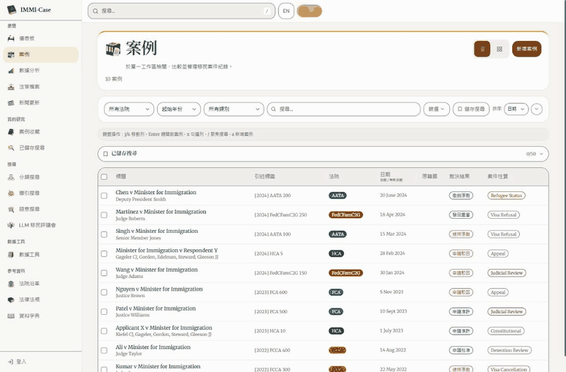

# 首頁、案例列表與數據分析：21st 元件改編

> 2026-10-26 整合更新：本頁保留原輪次的歷史驗證。後續程式碼審查、修正、提交與合併狀態以 [工作樹整合紀錄](reviews/2026-10-26-worktree-integration.md) 為準；本次未部署或推送。

2026-10-17。沿用 Legal Codex，以現有案例資料、圖表及 30 組／60 張透明明暗貼圖改善三個研究頁面。此版本在本機預覽，沒有部署、推送或提交。

## 實際搜尋與採用來源

使用指定的 `21st-cli-use` skill 與已安裝的 21st CLI，先搜尋 `dashboard stats card`、`animated tabs`、`animated icon buttons`，再取回完整元件與示例。沒有使用 hosted AI generation，也沒有新增套件。

| 來源 | 本次採用方式 |
|---|---|
| [Stats Card · kavikatiyar · 7841](https://21st.dev/@kavikatiyar/components/stats-card-1) | 採用指標卡片的數字層次、圖示配置與懸停抬升。沿用既有 StatCard 和真實數值；圖表與資料來源不變。 |
| [Animated Tabs · ibelick · 1115](https://21st.dev/@ibelick/components/animated-tabs) | 沿用上一輪改編的 CodexFilterRail，為首頁圖表／表格及案例表格／卡片提供滑動選取底片。保留原按鈕、名稱、鍵盤操作與儲存偏好。 |
| [Animated Tabs · kuratlielia · 35021](https://21st.dev/@kuratlielia/components/tabs) | 採用選取群組與內容進場模式，改編為研究介面的短過渡；分析章節使用真正的頁內連結，所有圖表同時保留。 |
| [Animated Icon Buttons · reuno-ui · 28541](https://21st.dev/@reuno-ui/components/skiper99) | 採用方向箭頭的懸停動態模式，配合既有貼圖的輕微抬升與旋轉，不替換可讀文字。 |

搜尋結果、完整原始元件與影響分析：[本輪證據資料夾](../.impeccable/review/core-21st-20261017/)。

## 畫面與操作

- 首頁先呈現四項核心數據，保留原情報摘要、分布圖表、近期案例、法院及期間篩選。頁首、指標及快速操作使用既有明暗貼圖。
- 案例列表保留搜尋、篩選、排序、表格／卡片、勾選、批次操作、收藏及分頁；新增清楚的篩選紙面、較大的檢視按鈕和列焦點提示。
- 分析頁新增五個章節捷徑，保留歷史結果、樣本限制、篩選條件及所有圖表。頁內連結移動鍵盤焦點，手機標題避開固定頂欄。跳轉時先展開圖表的實際高度，再校準位置；一般進入頁面時保留原來的延後繪製。
- 新動畫使用既有時長、間距、色彩、圓角及陰影。減少動態效果時取消新增動畫；原有 0.7 秒主題切換速度不變。

## 預覽

[首頁](http://localhost:5194/) · [案例列表](http://localhost:5194/cases) · [數據分析](http://localhost:5194/analytics)

本機服務使用獨立的 10 筆測試案例。畫面中的數量只供介面驗證，不代表正式資料庫數量。

| 頁面 | 桌面淺色 | 桌面深色 | 手機淺色 | 手機深色 |
|---|---|---|---|---|
| 首頁 | [查看](../.impeccable/review/core-21st-20261017/dashboard-light.png) | [查看](../.impeccable/review/core-21st-20261017/dashboard-dark.png) | [查看](../.impeccable/review/core-21st-20261017/dashboard-mobile-light.png) | [查看](../.impeccable/review/core-21st-20261017/dashboard-mobile-dark.png) |
| 案例列表 | [查看](../.impeccable/review/core-21st-20261017/cases-light.png) | [查看](../.impeccable/review/core-21st-20261017/cases-dark.png) | [查看](../.impeccable/review/core-21st-20261017/cases-mobile-light.png) | [查看](../.impeccable/review/core-21st-20261017/cases-mobile-dark.png) |
| 數據分析 | [查看](../.impeccable/review/core-21st-20261017/analytics-light.png) | [查看](../.impeccable/review/core-21st-20261017/analytics-dark.png) | [查看](../.impeccable/review/core-21st-20261017/analytics-mobile-light.png) | [查看](../.impeccable/review/core-21st-20261017/analytics-mobile-dark.png) |

這些是瀏覽器尺寸模擬與桌面瀏覽器結果，沒有宣稱實體手機或 Safari 驗證。

## 驗證結果

- 最後建置成功；TypeScript、ESLint 與三個調整過的 Python 操作測試檔檢查通過。
- 65 項相關前端測試通過，包含首頁、案例、分析及新聞回歸：[unit.json](../.impeccable/review/core-21st-20261017/unit.json)。
- 最後同一份建置的 75 項瀏覽器操作測試全部通過，涵蓋三頁、明暗與響應式：[e2e-final-build.xml](../.impeccable/review/core-21st-20261017/e2e-final-build.xml)、[完整輸出](../.impeccable/review/core-21st-20261017/e2e-final-build.log)。
- 修正舊測試對年份範圍連結、完整「Last 5 Years／Last 10 Years」標籤的過期預期；案例篩選改為等待真正的兩筆 FCA 結果，再檢查法院欄位，避免誤把保留舊資料的短暫狀態判成失敗。
- 390px 手機版與繁中／英文均無整頁橫向溢出。章節捷徑移動鍵盤焦點；最後手機標題頂部約 143.8px，位於 113px 頂欄下方。減少動態效果時，選取底片過渡為 0s、內容動畫為 none。
- 60 張正式素材的 SHA-256 雜湊全數一致；2,814 個受保護檔案無變更，包含資料、hooks、資料型別、Worker、新聞頁與樣式、分頁、手機選單、tokens 及套件清單。[素材結果](../.impeccable/review/core-21st-20261017/assets-result.json)、[保留結果](../.impeccable/review/core-21st-20261017/preservation-result.json)。
- 影響分析對部分 JSX 引用無法解析，已補查三個頁面在 App 的實際路由與 StatCard、CasesTable 的使用位置；沒有把 UNKNOWN 當成零影響。共用元件的程式保持原樣。

較早的中斷／失敗輸出保留作診斷，包含建置期間暫時不存在的靜態資源；以上只以最後穩定建置的完整結果作通過證據。

## 實際操作錄影

以下是 25 張真實瀏覽器畫面組成的 GIF，保留捕捉時間，僅等比例縮小與壓縮；沒有補畫動畫畫格。

