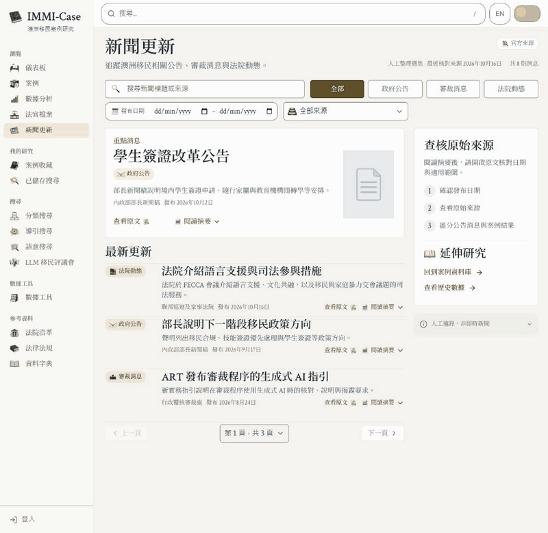

# 21st 動態元件採用紀錄（2026-10-17）

> 2026-10-26 整合更新：本頁保留原輪次的歷史驗證。後續程式碼審查、修正、提交與合併狀態以 [工作樹整合紀錄](reviews/2026-10-26-worktree-integration.md) 為準；本次未部署或推送。

已使用指定的 21st CLI 實際搜尋、取回三個元件原始碼，並改編為新聞頁的互動層。沿用 Legal Codex、原有版型、完整新聞文字與來源，以及 30 組明暗雙版本、共 60 張透明貼圖。

## 元件來源與實際採用

| 21st 來源 | 實際整合 |
|---|---|
| [Spotlight — kevingirelli](https://21st.dev/@kevingirelli/components/spotlight)，35180 | `CodexSpotlight.tsx` 採用每幀只更新兩個游標座標變數、卸載時取消動畫幀、觸控跳過的模式；改用既有 article 語意與主題 tokens，無額外依賴。卡片淡金聚光與邊緣提示只在滑過或內部鍵盤焦點時出現。 |
| [Animated Tabs — ibelick](https://21st.dev/@ibelick/components/animated-tabs)，1115 | `CodexFilterRail.tsx` 採用共用選取底片的互動模式，以瀏覽器 CSS transition 與實際按鈕位置改編，沒有加入 framer-motion。保留原有按鈕、aria-pressed、網址篩選與鍵盤行為；文字換行、字型載入與尺寸變化會重新定位。 |
| [Animated Icon Buttons — reuno-ui](https://21st.dev/@reuno-ui/components/skiper99)，28541 | 採用箭頭 hover 位移的微互動，延伸至新聞分頁及研究連結；現有透明貼圖在滑過時輕微抬起／旋轉，文件貼圖輕微傾斜。原圖示及貼圖檔案保持。 |

摘要保留原生 details／summary，補上內容淡入、微幅位移與箭頭旋轉過渡。所有新動態遵守 `prefers-reduced-motion`；未修改原有主題切換 0.7 秒與手機選單進出時間。新聞以外的頁面不新增聚光或選取底片。

## 檢索與程式來源

CLI 實際執行 `21st search`：`spotlight card`、`animated tabs`、`animated icons`，再分別 `21st get 35180/1115/28541 --json`。檢索與原始碼封存於 [21st-motion-20261017](../.impeccable/review/news/21st-motion-20261017/) 的 `search-*.json`、`component-*.json`、`catalog-*.tsx`。

這是對目錄程式與互動模式的本地改編，沒有宣稱三個元件原封安裝。作者與來源連結保留。未進行 hosted AI 生成、發布或帳戶寫入，也沒有新增套件或改變 package lock。

## 驗證結果

- Cloudflare 前端建置與本次三份程式的 ESLint 通過；新聞頁及資料測試 **16／16 通過**。
- 先前指定的煙霧、導覽、響應式三份操作測試 **114 通過、0 失敗／錯誤／跳過**（99.65 秒）。未將前輪 763 項前端結果宣稱為本輪重跑。
- 實際 1440×1400 視窗擷取、以單一比例正規化為 1440×1399，固定原稿整圖比對仍為 **80.31% MATCH**，19 區無 missing／contradicted。原稿、spec、框線及門檻未改，沒有 force。已開啟整圖並排及最弱三區目視確認。
- 真實動畫幀量測觀察到底片位移由 149.927 逐幀經 246.835、309.005 到 449.812；聚光兩個座標變數跟隨游標，邊緣透明度到 1，文件產生實際旋轉矩陣。
- 減少動態效果：底片 transition 為 0 秒，聚光透明度 0，文件 transform 為 none；測試後已清除瀏覽器模擬設定。
- 390 寬度手機無水平溢出，閱讀工具仍預設折疊；繁中分類底片與按鈕左緣差約 0.00003px、寬差 0。英文第二列分類底片亦對齊，寬差小於 0.02px；Enter 操作、完整摘要及來源核對日期可讀。
- 60／60 張正式貼圖雜湊保持。10／10 個保留檔案包括新聞 JSON、篩選、兩種分頁、手機選單、主題切換、正式 Worker、套件及 tokens 均保持。

原始證據：[browser-checks.json](../.impeccable/review/news/21st-motion-20261017/browser-checks.json)、[動畫幀量測](../.impeccable/review/news/21st-motion-20261017/category-animation-trace.json)、[整圖比對](../.impeccable/review/news/21st-motion-20261017/diff/report.json)、[操作測試](../.impeccable/review/news/21st-motion-20261017/e2e.xml)、[貼圖核對](../.impeccable/review/news/21st-motion-20261017/assets-after.json)、[保留檔案核對](../.impeccable/review/news/21st-motion-20261017/preserved-after.json)。

## 實際操作錄影

下圖由同一瀏覽器操作擷取的 49 幀編碼，原始畫格與時間戳保留於 `frames/`、`frames.json`。只等比例縮成 800 寬及編碼 GIF，沒有補畫動畫、替換內容或用它當作整圖比對輸入。

本機預覽：[新聞頁](http://localhost:5194/news)。案例 API 使用隔離十筆測試案例，八則官方新聞保持。未部署、提交或推送；手機尺寸模擬不代表實體裝置或 Safari 驗收。
