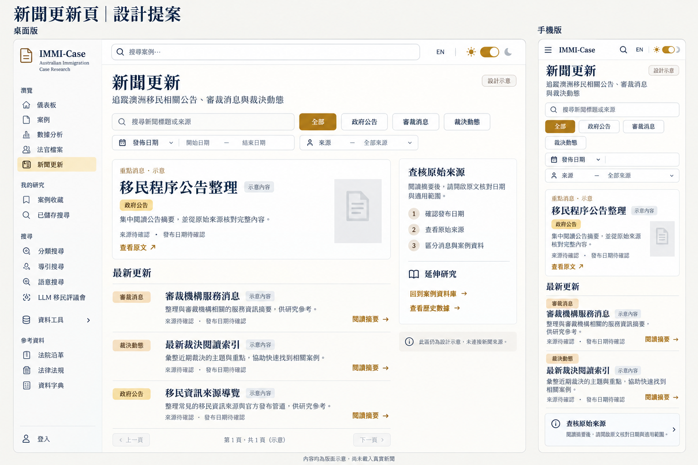

# 新聞更新頁：Legal Codex 設計與實作

> 2026-10-26 整合更新：本頁保留原輪次的歷史驗證。後續程式碼審查、修正、提交與合併狀態以 [工作樹整合紀錄](../reviews/2026-10-26-worktree-integration.md) 為準；本次未部署或推送。

2026-10-17 更新：已搜尋並改編 21st 的分類滑動底片、卡片游標聚光與圖示微動畫，保留版型及 60 張貼圖。16 項新聞測試及 114 項操作測試通過；寬版整圖比對仍為 80.31%。[查看來源、動態示範與驗證](../21st-motion-20261017.md)。

日期：2026-10-16。使用者先看設計圖片，再明確核准開始製作：「可以，就照這版開始製作新聞更新頁，沿用 Legal Codex 風格並保留現有資料與功能。新聞請使用可核對的真實來源，附上發布日期和原文連結。」

新聞頁已在前端實作於 `/news`。本輪寬版完整畫面在實際 1440×1400 視窗取得，正規化截圖為 1440×1399，與原稿比對 **80.31% MATCH**；首屏為 **79.33%**，兩者皆無遺漏或相互矛盾的區域。獨立複核已確認寬版修正批次可交付。後續選單動畫等待修正完成，先前那組 **114 項瀏覽器操作測試全部通過**；本機版本未正式部署。

這張原始提案以現有 `DESIGN.md` 與上一輪實際首頁截圖為視覺依據，由內建 imagegen 生成；完整生成指示見 [PROMPT.md](PROMPT.md)。原圖、生成指示及獨立的桌面比對裁切均予保留。圖片內的新聞文案、日期與分頁是版面示意；正式實作已換成下述真實來源，沒有把圖片嵌入頁面充當介面。

## 已實作的閱讀方式

- 一則編輯選定的重點消息搭配依發布時間排列的更新列表；分頁不重複列出重點消息。
- 每則附分類、發布機構、發布日期、自行整理的摘要與官方原文連結；可展開更多摘要及該則來源核對日期。原文在新分頁開啟。
- 可搜尋中英文標題、摘要及發布機構，並依政府公告、審裁動態、法院動態、來源與發布日期範圍篩選。
- 搜尋與篩選使用網址參數 `q`、`category`、`source`、`from`、`to`，分頁使用 `page`；無結果時可清除條件重新閱讀。
- 桌面沿用共用側欄與頂欄，主要閱讀區旁提供來源核對與延伸研究。手機改為單欄，閱讀工具預設折疊，日期控制可在窄畫面排列。
- 保留既有案例、分析、收藏與參考資料入口；新聞頁另提供回到案例庫與歷史分析的連結。

## 本輪寬版對齊

沿用 Legal Codex 與已交付的貼圖、字型及新聞分頁。本輪唯一實際程式更動在 `frontend/src/styles/news-codex.css`：桌面新聞頁使用一個受限制的基準大小，讓以 rem 定義的文字、間距與欄位一起按同一比例變化，最高為原基準的 150%（預設 16px 時上限 24px）；手機及其他路由仍為原 16px 基準。沒有個別搬移標題或文件圖，也沒有使用 transform 或 zoom 硬調畫面。

既有 `NewsPagination` 保留直接選頁、完整結果範圍及前後頁停用；原共用 `Pagination` 未修改。60 張正式貼圖、八則新聞資料、原稿、區域框與比對門檻均保留，沒有強制過關。

繁中標題新增自行託管的 `Codex Serif TC` 後備字型，來源是 Google Fonts 的 Noto Serif TC，保留 SIL Open Font License 1.1。西文仍優先使用 Crimson Text，調色盤與既有間距尺度未重建。字型來源與精簡範圍見 [fonts/provenance.json](fonts/provenance.json)。

本輪實際畫面：[原稿寬度首屏](final-narrow-desktop.png)／[1440 寬版完整畫面](final-desktop.png)／[1280 寬版](final-desktop-1280.png)／[1600 寬版](final-desktop-1600.png)／[英文深色版](final-english-dark.png)／[手機完整頁](final-mobile.png)／[手機首屏](final-mobile-viewport.png)。圖片直接複製實際瀏覽器的正規化畫格，沒有重畫、裁切或改內容。瀏覽器視窗與圖檔高度有少量取整尾差；完整尺寸與原始圖來源見 [VERIFICATION.md](VERIFICATION.md)。

## 透明貼圖交付

內建 image_gen 共產生 62 個獨立輸出：30 個主題各有淺色與深色版本，正式使用 60 張；另 2 張舊文件圖保留為封存紀錄。複核後的文件圖已換成單張折角紙 `document-v2`，其餘主題包含導覽、新聞分類、來源核對、日期、搜尋、篩選、原文與摘要等用途。

正式素材全部具透明背景。實際素材目錄 60/60 張載入，淺色與深色操作紀錄各確認 30/30 個主題載入，包含新版文件圖；這些素材用在導覽與真實操作／狀態，不只放在展示頁。[貼圖目錄畫面](sticker-catalog.png)及[素材來源與維護說明](sticker-assets/README.md)可供檢視；完整提示、原始 PNG、網址與檔案雜湊保留在同一素材目錄。

## 來源與更新範圍

首批為八則人工核對的官方消息，來自內政部部長新聞稿、行政覆核審裁處（ART）及聯邦巡迴及家事法院（FCFCOA）。最近一批來源核對日期為 **2026-10-16**；每則網址、發布日及日期差異說明見 [SOURCES.md](SOURCES.md)。

發布日期採個別原文頁的日期，不能用搜尋索引日期、核對日或政策生效日替代。摘要由本站自行整理，原始公告仍是核對範圍與內容的依據。法院類別稱為「法院動態」，不把一般法院消息標成裁決。

新聞由維護者手動選錄及更新，沒有建立自動排程、新聞爬蟲、訂閱或通知服務，也不宣稱完整或即時涵蓋。消息與歷史統計都不能預測個人案件結果。

## 維護方式

1. 編輯 `frontend/src/data/news.json` 前，逐頁閱讀官方原文，核對網址、發布日期與適用範圍，保留每則的穩定 `id` 及來源 `source`。
2. 補齊 `content.en`、`content.zh-TW` 的標題、簡短摘要與展開內容。`publishedAt` 記原文發布日，`verifiedAt` 記該則核對日；完成一批核對後更新整體 `reviewedAt`，並同步記錄於 [SOURCES.md](SOURCES.md)。
3. 沿用既有來源 ID；新增發布機構時補入 `sources`，並同步更新 `frontend/__tests__/news.test.ts` 中允許的官方網域。不要加入示範消息、推測日期或個案結果預測，也不要把新聞寫入案例資料庫。
4. 在 `frontend` 目錄執行新聞與頁面測試（`npm run test -- --run __tests__/news.test.ts __tests__/news-page.test.tsx`），再依專案流程檢查雙語、明暗主題、鍵盤、手機篩選與原文連結。建置及發布循既有審查流程；修改資料檔不會自動更新線上版本。

## 實作與驗證邊界

| 用途 | 檔案 |
|---|---|
| 新聞頁與閱讀工具 | `frontend/src/pages/NewsPage.tsx` |
| 篩選、日期、排序與分頁 | `frontend/src/lib/news.ts` |
| 人工整理的中英新聞資料 | `frontend/src/data/news.json` |
| 雙主題裝飾素材及新聞分頁 | `frontend/src/components/shared/CodexSticker.tsx`、`frontend/src/components/shared/NewsPagination.tsx` |
| 路由、共用導覽與預載 | `frontend/src/App.tsx`、`frontend/src/components/layout/nav-config.ts`、`frontend/src/lib/prefetch.ts` |
| 中英介面文字 | `frontend/src/i18n/locales/en.json`、`frontend/src/i18n/locales/zh-TW.json` |
| 沿用設計的對照記錄 | [DOCUMENTATION.md](DOCUMENTATION.md) |

寬版第二輪全前端 763 項及針對性 16 項通過；本輪最後單一 CSS 修正的 Cloudflare 前端建置成功，沒有把先前測試說成最後 CSS 修改後重新跑全套。最新實際操作確認新聞搜尋、直接第 3 頁、返回第 1 頁、英文完整摘要及手機選單退場；60 張正式素材及四個核心資料／程式檔雜湊不變。

後續只修改測試輔助函式 `close_mobile_menu`，點擊關閉後等待同一個選單確實隱藏，再繼續原有斷言。沒有固定睡眠、跳過或放寬斷言，也沒有修改網站與動畫。先前那組煙霧、導覽與響應式操作測試現為 **114 通過、0 失敗、0 跳過**，原失敗單項及重複檢查也通過，Ruff 通過。305 個前端程式與公開素材檔、60 張正式貼圖及四個核心檔案均核對保留；修正前 113／1 與單項失敗紀錄仍保留為歷史。完整前後證據見 [選單等待修正紀錄](../../.impeccable/review/news/menu-wait-fix/RESULT.md)。這是先前指定三份測試的結果，不代表重新執行整個專案的所有測試。

新的獨立複核以本次單一 CSS 修正批次給出 `ship`，寬版機械比對正常通過，`review` 已關閉並正式記錄 `finish: ship`，沒有 force；這不是全站無回歸或所有自動測試通過的保證。正式複核、兩次失敗紀錄與範圍見 [VERIFICATION.md](VERIFICATION.md)。本機預覽仍為 `localhost:5194/news`，案例 API 使用隔離十筆測試案例；新聞仍為八則真實官方消息。未部署、提交或推送。

## 前輪紀錄

先前「再調整一輪首屏密度」已獨立結案，當時繁中 1127×911 重點高度 226.22→166.25px、分頁底端 989.92→885.97px；英文分頁底端為 999.70px。當時首屏 67.6%／桌面 63.09% 與前端 762 項是歷史結果，不是本輪畫面或測試狀態。詳細輪次分界見 [VERIFICATION.md](VERIFICATION.md)。

本次寬版修正前，素材交付輪的 78.40% 同尺寸結果、63.27% 寬版未過及 8 項最末重驗亦屬歷史；目前以 wide-round3 的完整寬版 80.31% 為準。
