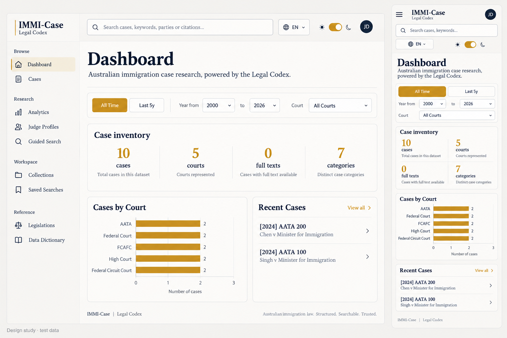

# 前台介面評析與升級紀錄

> 2026-10-26 整合更新：本頁保留原輪次的歷史驗證。後續程式碼審查、修正、提交與合併狀態以 [工作樹整合紀錄](../reviews/2026-10-26-worktree-integration.md) 為準；本次未部署或推送。

日期：2026-10-16（Australia/Sydney）。範圍：`frontend/src`。正式服務未部署；原有工作區修改保留。

## 使用者確認的方向

- 保留實用資料、來源連結與 Legal Codex 識別。
- 首頁以案例數據總覽為優先，搜尋為輔助入口。
- 分析改以歷史結果表述，樣本限制直接伴隨數字。
- 新頁面先製作設計圖片；已記錄 `buildPath: comp`。
- 新聞更新頁是後續構想，來源、更新方式與實作範圍尚未決定。

## 21st 搜尋與取捨

以 `21st search` 搜尋 dashboard sidebar、data table filter、command search、pagination、skeleton loading、tabs。查過登入狀態與方案；沒有使用 hosted AI generation。

| 候選 | 用途與取捨 |
|---|---|
| [Dashboard Sidebar](https://21st.dev/@arunjdass/components/dashboard-sidebar) | 已用 `21st get 14941` 讀取原始碼。採取導覽分組、清楚的搜尋入口與選取回饋方向；其虛構工作區、方案內容與可點擊 div 不適合直接取代既有實作。 |
| [Sidebar](https://21st.dev/@wensity/components/sidebar) | 比較分組與側欄結構；保留原專案的路由、預載與權限處理。 |
| [Table](https://21st.dev/@originui/components/table) | 比較表格篩選排列；調整既有表單層級與寬度，避免換掉案例資料介面。 |
| [Command Menu with Global Search](https://21st.dev/@ephraimduncan/components/command-menu-04) | 比較搜尋提示與狀態回饋；沿用原有搜尋端點及 Radix 焦點管理。 |
| [Pagination](https://21st.dev/@originui/components/pagination) | 比較分頁導覽；保留既有頁碼演算法，改善操作名稱與點按尺寸。 |
| [Skeleton Swap](https://21st.dev/@ddoemonn/components/skeleton-swap) | 保留原有載入及資料不足狀態，避免以假資料預覽冒充內容。 |
| [Tabs](https://21st.dev/@sean0205/components/tabs) | 作為比較候選；沒有因目錄存在就加入不需要的元件依賴。 |

此次是依目錄比較後改良現有元件，沒有整套安裝第三方主題，也不宣稱所有 21st 元件都可一鍵更新。介面套件只更新目前允許的相容版本；主要版本遷移另需評估。

`react-router-dom` 7.18.4 保留新版的拒絕外部導覽保護。官方 7.18.3 更新記錄明確增加客戶端網址驗證；安裝碼的 `validateNavigationTarget(..., "reject")` 在跳轉前拒絕外部來源。舊測試預期把這些輸入改寫成站內路徑，現改為同時驗證明確拒絕與仍停在 `/start`，一般站內連結仍需成功。來源：[官方變更紀錄](https://reactrouter.com/7.18.4/changelog#v7183)。

## 設計示意圖

以內建 imagegen 製作，先於 UI 原始碼修改。圖片是設計參考，非網站截圖或資料證據。保留紙色、海軍藍、琥珀金、襯線標題；擷取搜尋、分組、間距及手機排列方向。圖片中的頭像、標語與簡化圖表不作為產品事實加入網站。實作保留全部既有法院色碼、圖表與資料。

## 獨立評析方法

Method: dual-agent（A: `/root/design_assessment`；B: `/root/quality_assessment`）。A 在接收 detector 結果前完成判斷。B 的結果等待 A 完成後才送入整合。使用獨立隱藏 IAB 分頁；代表頁為 Dashboard、Cases、Analytics，隔離十筆測試案例，不代表正式案例庫。

### 現況設計評分

| 原則 | 分數 | 現況依據 |
|---|---:|---|
| 系統狀態 | 3/4 | 篩選、案件數及目前頁清楚。 |
| 熟悉用語 | 2/4 | 法院縮寫、Semantic Search、LLM Council 等需背景知識。 |
| 操作退出 | 3/4 | 查無結果可清除條件，對話框有退出路徑。 |
| 一致性 | 3/4 | 視覺一致，但篩選排列與保留方式不同。 |
| 預防誤解 | 2/4 | 成功率與評級可能被當成個案預測。 |
| 辨認優於記憶 | 2/4 | 導覽過多，跨頁研究範圍丟失。 |
| 效率與彈性 | 3/4 | 快捷鍵、收藏、批次操作完整。 |
| 精簡與美感 | 2/4 | 首頁多層摘要競爭注意力。 |
| 錯誤恢復 | 2/4 | 有重試，但部分原始錯誤訊息不易理解。 |
| 說明與協助 | 2/4 | 有導引與字典，未完全貼近當下決策。 |
| **合計** | **24/40** | **修改前評分；沒有把局部修正冒充重新獨立評分。** |

### 設計專屬性與情緒旅程

法院識別、引註與報告式編排形成 Legal Codex 的權威感。首次進入能建立信任，但十四個並列入口及多層摘要讓初學者先理解工具分類才能開始；查無結果仍能恢復，控制感回升；醒目的成功率可能造成不恰當的確定感；跨頁範圍重設又打斷研究脈絡。

認知負荷八項中，單一焦點、小量分組、視覺優先次序、一次一個決定、選項精簡、跨頁記憶六項未通過；關聯分組與逐步展開進階功能通過。優點是品牌一致、搜尋有恢復路徑、熟練者已有快捷操作。

### 優先問題與處理

| 等級 | 問題與影響 | 處理 |
|---|---|---|
| P1 | 深色金色按鈕白字只有約 2.7:1，難以辨識。 | 共用重點底色搭配 `--color-on-solid`；FCCA 保留識別底色並使用深文字。 |
| P2 | 全域 select 撐滿整列，搜尋輸入的內距被覆蓋。 | 表單基底移入 base layer，寬度由元件決定；搜尋保留彈性空間。 |
| P1 | Dashboard 的 FCA 範圍進入 Analytics 後變回全部法院。 | 將法院與起迄年份放入網址，分析頁驗證並讀取，支援返回與重新整理。 |
| P1 | 計算器選單無名稱、概念選取缺狀態、搜尋關閉無名稱。 | 新增可讀名稱、選取狀態與搜尋載入／錯誤／重試提示。 |
| P1 | 首頁資訊及成功率容易造成理解負擔。 | 依使用者確認保留總覽優先；導覽分組縮短，分析改成歷史結果並直接顯示樣本限制。 |

Jordan（新手）容易卡在不同搜尋方法的用途；Alex（熟練研究者）會被跨頁重設打斷；Sam（輔助工具使用者）會遇到無名稱選單；壓力下的申請人可能過度記住醒目百分比。上述問題指向具體操作，不代表已做使用者實測。

### 技術掃描與誤報處理

B 的 CLI 掃描涵蓋 119 檔，1 warning、0 error：`AchievementToast.tsx:46` 的回彈曲線（P3）。已改為平順離場與低動態版本；修正後 CLI 回傳 `[]`。

瀏覽器覆層在三頁均成功注入並截圖；工具宣告數量與逐列 console 數不一致，因此不將它們合計成已確認缺陷。已排除既有日夜切換光暈、正常圖表色碼、矩陣自身配對的破折號、表格外框內距，以及 detector 自身標籤造成的水平溢位。

仍需留意的候選包括小尺寸圖表標籤、概念的就地說明及完整錯誤訊息整理。不得將這次共用元件升級描述成所有歷史介面缺點已消失。

### 已回覆的評析問題

使用者選擇「閱讀案例數據總覽」及「改用歷史結果的說法，直接附上樣本限制」。依序執行 adapt（排列與點按）、animate（導覽與浮層）、歷史結果說明、跨頁範圍修正，再進行整批驗證。

## 驗證與範圍

驗證結果另列於 `VERIFICATION.md`。自動測試、瀏覽器尺寸模擬、實體裝置驗收分別記錄。沒有執行付費 Council 工作、登入真實帳號、修改正式資料或部署。
