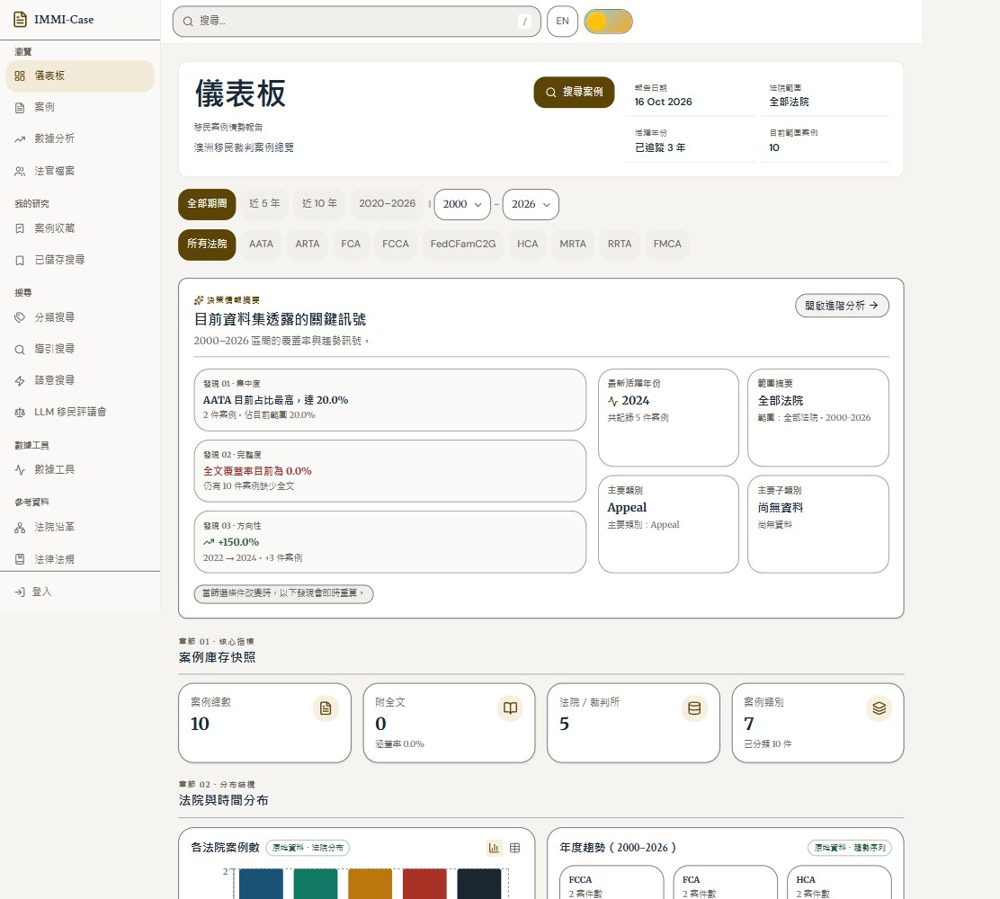
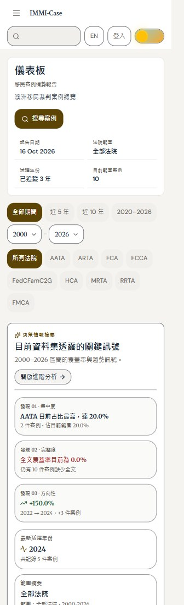
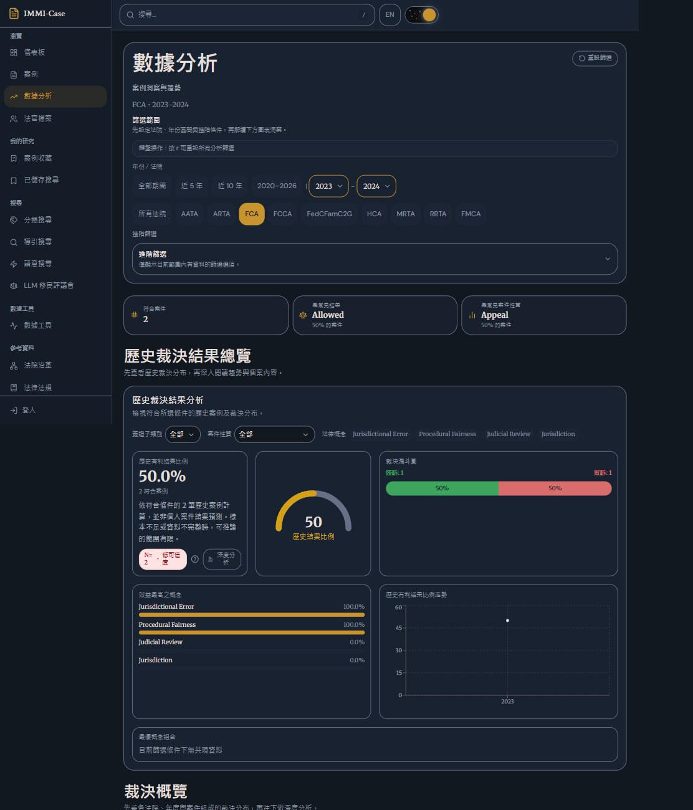

# 前台升級驗證紀錄

> 2026-10-26 整合更新：本頁保留原輪次的歷史驗證。後續程式碼審查、修正、提交與合併狀態以 [工作樹整合紀錄](../reviews/2026-10-26-worktree-integration.md) 為準；本次未部署或推送。

日期：2026-10-16。評析、候選來源與取捨見 [REVIEW.md](REVIEW.md)；設計規範見 [DESIGN.md](../../DESIGN.md)。

## 已完成

沿用 Legal Codex，更新十個主要介面套件的相容版本。共用導覽、搜尋、表單、分頁、篩選、浮層及載入狀態已改善；首頁維持案例數據總覽優先，分析改用歷史結果及直接樣本限制。首頁連往分析時帶入法院與年份。

使用者指定的 21st 搜尋、Impeccable init、document、audit、animate、adapt、critique 均已執行。兩個獨立評估代理的修改前評分為 24/40，沒有把此次修正重新包裝成獨立評分。新聞頁仍是待決定的擴充。

## 自動驗證

| 檢查 | 結果 |
|---|---|
| 完整前台 `vitest run --maxWorkers=2` | 90 檔、747 項通過，188.44 秒。 |
| 最後選單箭頭間距調整後的 CSS／色碼／操作檢查 | 3 檔、55 項通過。 |
| 歷史結果用語統一後的翻譯與分析篩選檢查 | 2 檔、22 項通過；前台重新打包成功。 |
| 本次修改的 22 個介面原始碼檔 ESLint | 通過，沒有輸出錯誤。 |
| TypeScript 與 Cloudflare 前台建置 | 通過；產出位於 `frontend/dist`。 |
| Impeccable 修正後掃描 | `detector-after.json` 回傳 `[]`。 |

完整測試先找出過期色碼例外清單；移除已不再含硬編碼色碼的 OutcomeFunnelChart 紀錄後，完整重跑通過。Router 的外部網址測試改為驗證新版明確拒絕，仍保留站內導覽成功斷言；沒有降低安全保護。

測試原始紀錄位於 WSL `/tmp/immi-ui-tests-delivery-final.log`、`/tmp/immi-ui-css-final.log`、`/tmp/immi-ui-lint-delivery.log`。最後 CSS 調整不涉及操作邏輯，另跑上述相關檢查。

最後僅變更中英文圖表用語後，以 `/tmp/immi-ui-copy-final.log` 及 `/tmp/immi-ui-build-copy-final.log` 確認翻譯、篩選與打包；另重查分析頁 321、391、844、1280 寬均無整頁水平溢出。使用者可見的分析標籤以歷史結果表述，資料欄位名稱與計算定義保留相容。

## 實際瀏覽器

使用內建瀏覽器載入建置產物，連接隔離的十筆測試案例。沒有使用正式案例庫。測試用 Flask 僅供這次本機驗證，不是正式服務。

- 首頁、案例列表、分析頁：九種尺寸，共 27 組沒有整頁水平溢出。實際 CSS 寬度為 321、391、540、768、844、1024、1280、1920、2560；844 寬時高度 391，另涵蓋手機直向、摺疊寬度、平板、桌面及寬螢幕。尺寸與量測見 `responsive-final.json`。
- 其他十五個手機路由可顯示主要內容，沒有整頁水平溢出：收藏、已儲存搜尋、分類導引、導引搜尋、語意搜尋、評議會、資料工具、法院沿革、法規、資料字典、法官檔案、案例內容、新增案例、案例對照、登入。見 `routes-final.json`。分類路由沿用目前的導引搜尋介面。
- 手機選單有十四個一般使用者入口，焦點留在選單內；動畫結束後關閉並回到選單按鈕。管理入口依同一權限條件處理。
- 搜尋輸入 Chen 後取得對應測試案例；Escape 關閉後焦點回到搜尋按鈕。
- 首頁選 FCA、2023–2024，連往 `/analytics?court=FCA&year_from=2023&year_to=2024`；顯示「依符合條件的 2 筆歷史案例計算，並非個人案件結果預測。樣本不足或資料不完整時，可推論的範圍有限。」
- 實際切換英文／繁體中文與明暗主題。一般日夜切換保留 0.7 秒；模擬減少動態效果時，抽屜改為淡入，日夜球體不做位置移動。測試設定完成後還原。

操作與最後載入的打包檔名見 `flows-final.json`。

瀏覽器既有縮放為 80%，使用尺寸工具補償並記錄實際 CSS 寬度；沒有永久更改瀏覽器縮放。表格內的正常橫向捲動不算整頁溢出。第一輪發現的分析圖卡寬度及焦點問題已修正；最終截圖另核對年份文字與箭頭間距。

畫面截圖均來自實際建置產物與隔離測試資料：

## 實作與資料邊界

沒有部署、提交或推送。未執行付費評議會、真實登入、資料寫入或資料搬遷；保留原有尚未提交的後端與登入修改。全站原有髒改動令 GitNexus 整體差異呈現高風險，不能將該結果歸因於此次 UI 修改。

GitNexus 已對修改的原有函式執行影響檢查；部分 JSX 引用與測試常數未收錄，另以實際引用及測試確認。更新後的 WSL 套件快取位於 `/root/.cache/immi-case-ui-20261016`；原套件資料夾保留在 `frontend/.ui-runtime-backup-20261016/node_modules`，沒有刪除。此調整是為了避免 Windows 磁碟上的套件讀取拖慢驗證。

這是 Chromium 瀏覽器尺寸模擬，不代表實體 iPhone、Android、Safari 或完整螢幕閱讀器驗收。正式 Cloudflare 環境、真實登入後跨租戶操作及新聞資料服務均未在本輪驗證。

完成後已還原暫時的尺寸與減少動態效果設定，關閉臨時分頁與測試服務；8193、5194、8400 均確認不再監聽。程式與建置產物保留在專案內。
